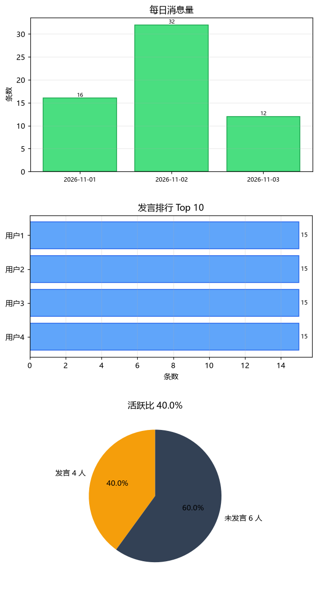

# QQ 群聊统计工具

选一个群、选一段时间，统计：**消息总数、发言人数、每人发言条数、活跃比**，并画成图表。



## 它是怎么拿到数据的

QQ 的本地聊天数据库是加密的，直接读不现实。本工具走的是**协议端接口**：

```
QQ 小号 ──登录──> NapCat / SnowLuma ──HTTP(OneBot v11)──> 本工具
```

所以前提是：**你已经有一个正在运行的 NapCat / SnowLuma**，并且开了 HTTP 服务。

## 快速开始

```powershell
cd qq-group-stats
python -m pip install -r requirements.txt
python main.py
```

界面三步：

1. **连接**：地址填 `http://127.0.0.1:3000`，Token 填协议端里设的（没设就留空），点「连接」
2. **选群 + 日期**：下拉选群，填开始/结束日期（`YYYY-MM-DD`，含首尾两天）
3. **开始统计**：等进度条跑完，看三个标签页和下方摘要

## 三个图表

| 标签页 | 内容 |
| --- | --- |
| 每日趋势 | 每天的消息条数 |
| 发言排行 | 发言最多的 Top 10 |
| 活跃比 | 发言人数 vs 群成员总数（饼图） |

## 活跃比怎么算

```
活跃比 = 区间内发过言的人数 / 群成员总数
```

参考档位：

| 活跃比 | 判定 |
| --- | --- |
| ≥ 60% | 非常活跃 |
| 30% ~ 60% | 比较活跃 |
| 10% ~ 30% | 一般 |
| < 10% | 比较冷清 |

## 协议端怎么开 HTTP

**NapCat**：WebUI → 网络配置 → 新建 **HTTP 服务器** → 端口 `3000` → 设 Token → 启用

**SnowLuma**：设置里开启 OneBot v11 HTTP，端口默认 3000

## 常见问题

| 现象 | 原因 | 解决 |
| --- | --- | --- |
| 连接失败 | 协议端没开 HTTP | 按上面开一个 HTTP 服务器 |
| HTTP 401 | Token 不一致 | 两边填一样的 |
| 群列表为空 | 小号没加群 | 先加群 |
| 统计很慢 | 消息多、翻页多 | 缩小日期范围 |
| 图表中文变方块 | 缺字体 | 装微软雅黑，或用 Windows 默认（本程序已设） |

## 项目结构

```
qq-group-stats/
├── main.py        # Tkinter 界面
├── onebot.py      # OneBot HTTP 客户端（群列表/成员/历史消息 + 翻页）
├── stats.py       # 统计逻辑（纯函数，可单测）
├── charts.py      # matplotlib 图表
└── requirements.txt
```

## 已知限制

- 只能统计**协议端能拉到**的消息；超过机器人保存期限的会被清空
- 群成员数取的是当前人数，不是区间当时的人数
- 拉取速度受协议端限制，大群大跨度会比较慢

## License

MIT

---

## 离线模式（不开任何服务）

不想启动 NapCat？用 QQ 自带的导出功能，完全离线统计。

### 步骤

1. PC QQ → **消息管理器**（左下角三横线 → 消息管理器）
2. 左侧选中要统计的群
3. 右键 → **导出消息记录** → 格式选 **txt**
4. 运行：

`powershell
python main_offline.py
`

5. 点「浏览」选导出的 txt，填群人数（可选），选日期，点「开始统计」

### 两种模式对比

| | 在线模式（main.py） | 离线模式（main_offline.py） |
| --- | --- | --- |
| 需要协议端 | 要 | **不要** |
| 数据来源 | NapCat 实时接口 | 导出的 txt |
| 群成员数 | 自动获取 | **手动填** |
| 消息范围 | 协议端保存的 | 你导出的 |
| 适用 | 日常查看 | 一次性复盘、没装 NapCat |

### 导出的 txt 格式

程序能识别这两种标题行：

`
2026-11-01 12:00:00 昵称(123456)
2026-11-01 12:00:00 昵称<123456>
`

识别不了的话，把文件前几行发我，我加规则。
